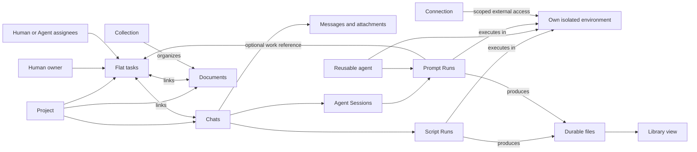
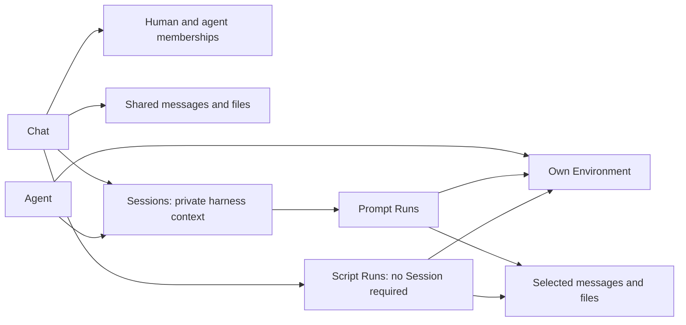
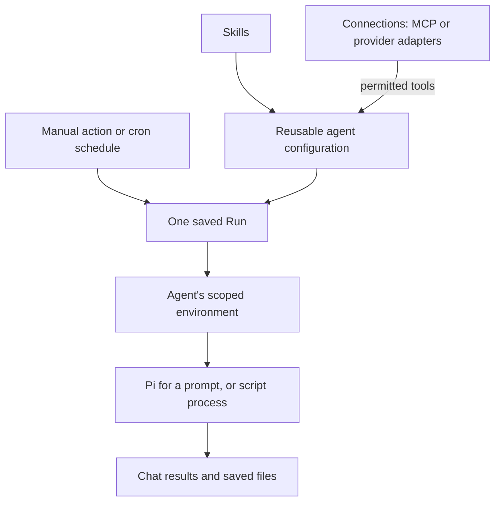
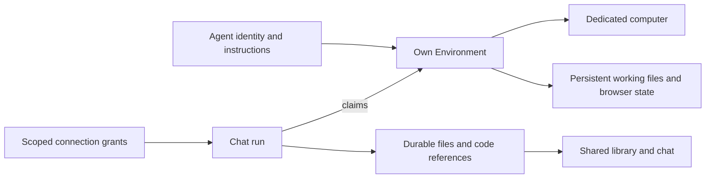
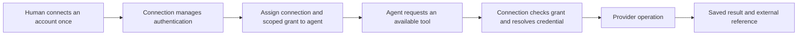
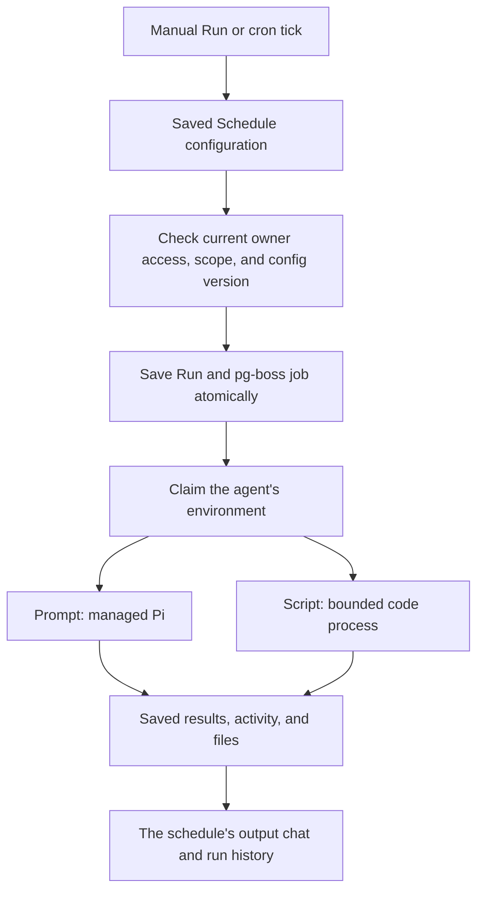
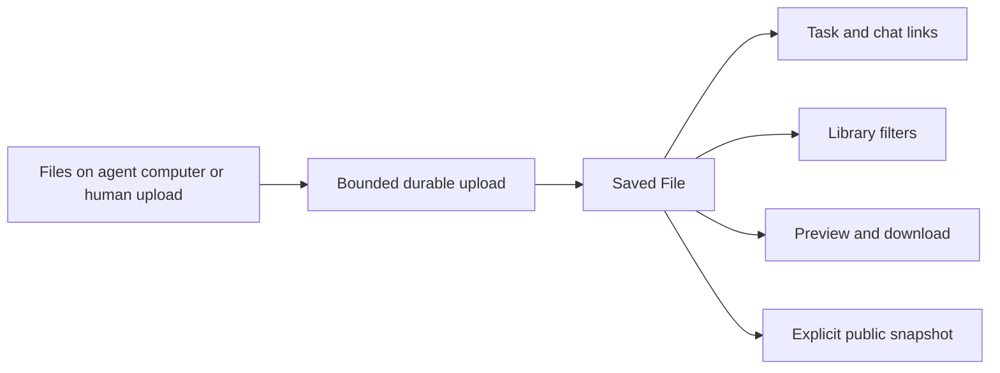
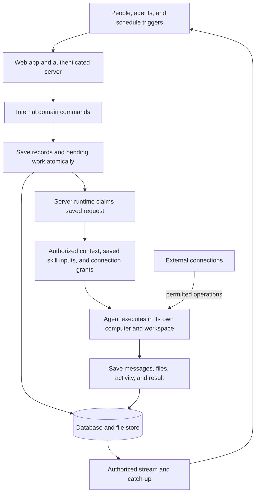
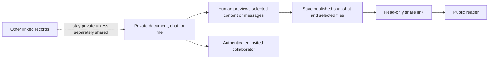
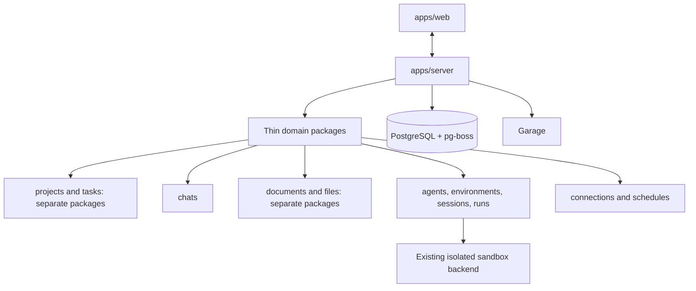

# Otto plan

Product plan; execution architecture amended 3 October 2026

**Current decision:** Pi is the runtime of every Agent, for coding, research, writing and other tool work. Otto packages/manages Pi and one account/model gateway; CLIProxyAPI is the single managed gateway, initially Codex OAuth/Responses; Magpie remains historical research. Users connect supported accounts through Otto and choose the authorized account/model. The model reasons, Pi executes the loop/tools, the gateway supplies upstream auth/model access, and Otto retains records, authority and collaboration. This intentionally replaces the native-harness/native-computer-login requirement. Current code uses Pi RPC and gateway authentication; previous ACP tests/reviews remain historical, not Pi/gateway proof. See [the source-backed replacement map](../pi-gateway-plan.md). Compute provider/provisioning/isolation remain deferred.

Historical planning note (1 October):

Simplification pass: artifact and document history, skill publishing, and automation content versions are removed. Domain packages follow the records they own. Argus passed the simplification, Bun/Vitest, queue-schema clarifications, and stack comparison with no blockers (9/10 across all criteria). The human has now selected the web/server libraries below. Pino is now selected for logging. Credential storage for a fresh installation remains open. All Otto product models stay independent of integration providers; VM/backend selection is deferred. Argus passed the cross-domain provider rule and code guide with no findings, 9/10 across all criteria. Implementation and integration behavior remain unverified beyond the small Vitest smoke noted below.

## Purpose

Otto combines shared project work, flexible documents, and Pi-powered agents. Keep tasks flat, reuse Pi, and make the normal path capture → run → discuss → save result. Questions and chats need no task.

Use a few records in several ways. A Chat can look like a direct or group discussion without a type field. A Document can be a note, specification, or skill. A Session keeps one agent's private continuing context; a Run is one execution attempt. Views do not create copies.

## The primitives

| Record | Minimum useful shape |
| --- | --- |
| Project | Members, defaults, repository links, related work |
| Task | Project, title, notes, required human owner, zero or many human/Agent assignees, optional due date and recurrence, To do / Doing / Done, links |
| Chat | Workspace, creator, optional Project, workspace/participants visibility, participant roles, messages, replies, mentions, attachments |
| Document | Title, current body, basic properties, attachments, visibility; skills use this model |
| Collection | Fields and table/list views over Documents; not a general database builder |
| File | One saved output: stored bytes, title, kind, labels, creator, optional source Run, access |
| Agent | Instructions, authorized account/model, skills, assigned Connections, own Environment; managed Pi runtime |
| Environment | An agent's isolated computer, persistent working files, browser state, lifecycle |
| Connection | External GitHub/MCP account, credential management, adapter, scoped agent grants |
| Subscription | AI account metadata, creator, visibility and trusted gateway qualification status (intended) |
| Session | One agent's private harness context, bound to a Chat, Environment scope, and account |
| Run | One prompt or script attempt: human sponsor, saved inputs, scope, state, execution reference, outcome |
| Schedule | Human owner, Agent, output Chat (which determines Project), prompt or script body, manual/cron trigger |

Workspace membership supplies human identities. Human and agent references support participation, authorship, and assignment; no profile per feature. Messages, memberships, files, grants, jobs, and share links are supporting records. The library is a filtered Resource view. The working directory and computer are parts of Environment.

## Relationships without nesting

Tasks belong to a Project. Chats, Documents, Collections, and Files have a workspace home and optional Project. A Collection initially organizes Documents only; the File library uses ordinary filters. Links stay within a workspace and never grant access.

Every Task has an eligible human owner. Human-created tasks default to their creator; agent-created tasks name a sponsoring human or fail creation. Assignee edits change the assignee sets, not ownership. A recurring Task creates its next occurrence only when an authorized human completes it; see [Tasks](../tasks.md). Transfer open tasks before removing their owner. Agents can propose completion; only an authorized human marks Done.

Tasks also own manual time entries in `timesheets`: workspace, Task, server-derived human `createdBy`, server logging `createdAt`, positive whole-minute `duration`, and optional notes (at most 4000 UTF-8 bytes). Only the author with current Task writer access can log/correct/remove their entries; admins cannot edit another person's time. Current Task readers can read them. Done and archived Tasks remain available for authorized logging/correction. Lookup requires a Task, with optional creator and logging-date filters, exclusive UUID pagination and bounded pages. There is no timer, billing, backdating, runtime-derived human time or reporting framework.

One Chat can discuss several Tasks and hold several agents' Sessions. A Run belongs to a Chat and agent, with optional Task and Schedule references. Prompt Runs require a Session; scripts do not. Saved Files can be linked from several places without copying their files.

Keep “Fix sign-in,” “Write welcome copy,” and “Check onboarding” as visible peer Tasks. Direct links and labels are enough; no subtask hierarchy.

## Chats and sessions

Chat owns shared messages and explicit participant relationships. Store memberships in a table with exactly one existing human or agent reference in the same workspace and a unique participant per Chat; response arrays are only a convenience. Direct or group presentation derives from participants, not a type field. Chat visibility is `workspace` or `participants`; both intersect current workspace/Project membership. Agents always need an explicit participant row, and an explicit viewer role caps writes. Server-derived `createdBy` controls metadata, archive and participant management with current writer/Project authorization; eligible participants still discuss and control authorized Runs. Joining never expands an agent's tool grants.

Session owns one agent's continuing private Pi context in the intended implementation. It records its Chat, agent, Environment binding, permission scope, pinned Pi installation, accepted account/model, and private context reference. Prompt admission validates these against the Run; create a fresh Session and Run atomically when needed. No implicit cross-chat reuse. Several Sessions can use one agent's Environment queue.

Within the same permission scope, a fresh Session resets model context while retaining shared messages and working files. Changed permission scope requires separately isolated working state or an explicit reset. Before continuation, recheck the retained context's source permissions and output audience. Unauthorized retained context requires a fresh Session; filtering the next prompt cannot erase prior knowledge.

People can supervise, steer, answer, and stop permitted Runs. Human chat, agent replies, and agent-to-agent requests use the same saved messages. Directed requests wake only their intended permitted agent, with saved acknowledgement, deduplicated delivery, and bounded handoffs. Informational messages do not wake every agent. Tool activity stays expandable. Public sharing selects visible messages and outputs, never private Session history.

## How agents, skills, connections, and schedules fit

The model supplies reasoning; Pi executes the Agent loop and tools. The selected gateway supplies upstream authentication/model access. Otto owns collaboration, accepted context, execution authority, scoped tools and saved results. Pi is used for every Agent, not just coding.

- Agent = who works, its instructions and selected authorized account/model; Pi is managed by Otto.
- Skill = reusable instructions and supporting files in its own domain.
- Connection = capabilities and external authentication; MCP is one adapter.
- Schedule = what to start and when.
- Session = continuing private context; Run = one attempt.

Agents, Skills, Documents, Files, Connections and Subscriptions use `visibility: user | workspace` within the existing workspace. The server assigns their human creator/maintainer as `createdBy`; Files retain the distinct human custodian/sponsor `ownerId` and optional `creatorAgentId`. User visibility restricts discovery/read/use to that human; workspace visibility permits eligible current members subject to Project, Chat and explicit Agent grants. Configuration and sharing remain creator-controlled. Sharing an Agent never shares a user-scoped dependency, credential or private Session. Skills are a separate domain and table; Documents contain ordinary content and Collections. Documents and Files use that same visibility and creator/custodian-controlled edits; per-user collaborator grants are deferred.

Agent is the sole reusable skill/Connection configuration. Connections use `type: github | mcp` and the existing many-to-many scoped `connection_grants`. AI accounts use Subscriptions, distinct from Pi and external Connections: one accepted `subscriptionId` per attempt/Session. Subscription status is `needs_auth | enabled | disabled`; the intended gateway integration enables it only after trusted account-specific qualification, never a browser status assertion. Current code still uses native Computer proof. No new credential/auth tables or billing-management product is implied. Models remain configured IDs. Projects and manual Runs have no skill defaults or overrides. Bounded manual Run Document/message/Task selections are execution content with explicit current source and output-audience checks; they are not standing grants and are not moved into Agent fields.

Skills never grant permissions. A tool is a scoped Otto operation, Environment operation, or assigned Connection capability. An MCP server needs no extra profile. A workflow initially means one prompt or script Schedule; scripts may have ordinary code steps.

## Documents, collections, and skills

Store the current Document body and basic typed properties. Use an established editor, table/list views, and text, number, date, checkbox, select, human/agent, and record-reference fields. Stable field IDs survive renaming. References grant no access. Save edits atomically and reject stale edits using an edit token; do not build a revision-history system.

Skills are separate records: title, when to use it, human maintainer, instructions, and optional supporting files. Authorized humans edit; agents propose changes. Select reusable skills only on an Agent through the workspace-safe `agents_skills` relation; bounded `skillIds` is an input/projection, not another persisted array. No draft/publish ceremony or skill version browser.

Support the [Agent Skills format](https://agentskills.io/specification): import/export SKILL.md and optional scripts, references, and assets. Skills remain authoritative; generated Pi files are execution copies. Save the exact supplied prompt, skill instructions/catalog, and supporting file references with the Run, so later edits affect future attempts only. Lazy-loaded skill material must come from that saved input set, not the latest Skill. Supporting-file references pin immutable stored bytes; edits save a new file key and never overwrite bytes referenced by a Run or public share. Retain those files while referenced. Track actual activation only when the harness reports it. Skill scripts obey the Environment and Connection rules.

This input snapshot is execution evidence, not reusable document versioning. Formula engines, rollups, nested pages, real-time co-editing, and an arbitrary database builder wait.

## Each agent gets an environment

The intended compute model gives each Agent its own computer, files, processes and browser profile. Upstream account authentication belongs to the managed gateway, not a required vendor login inside each computer. Several agents run concurrently from day one; initially lease each Environment to one active Run. Project checkouts use separate branches for parallel writers. A directory or worktree alone is not isolation.

Bound compute resources, disk, runtime, captured output, uploads, previews, queued work, and retries. Retry safe bookkeeping with finite backoff; propagate failures or retain durable retry work, and show a terminal failure/interrupted state when recovery cannot succeed. Stop reports whether the process tree actually stopped; it does not undo completed changes.

Once a compute backend is selected and qualified, apps/server assigns the workspace and starts managed Pi through that backend. Reuse create/start/execute/inspect/stop/reset operations and an interactive process transport with stdin, streaming output, process identity, and targeted process-tree termination. No separate Otto runner app or required agent-side daemon.

Save the launch identity before dispatch and the backend execution reference afterward. Reconcile lost acknowledgements and server restarts rather than launching another copy. The backend must enforce the deadline if the server disappears. Replacement waits until the old execution is confirmed stopped or fenced from both execution and external operations; a database generation does not kill a process. Fence stale progress writes.

Pause stops or checkpoints the active Run before suspending compute and preserves files; running-process resume is conditional. Reset/replacement warns about unpublished local work. Saved Files, messages, and pushed code survive independently; local files need retained volumes or backup. Working state from another permission scope cannot leak through files or browser history: isolate it or explicitly reset before reuse.

[Mastra's workspace model](https://mastra.ai/docs/sandbox/overview) is a reference, not an adopted harness. Its default LocalSandbox runs on the application host without isolation; file-tool containment alone does not restrict shell commands. This backend phase implements models and the small typed internal computer boundary with controlled fixtures. Cloud/local provider selection, provisioning and real isolation/lifecycle qualification are deferred; add no provider registry or automatic host-local fallback.

## External connections

Connect an account once, assign scoped resource/action grants to agents, and use it. Connections own authentication, refresh, discovery, expiry, disconnect, and secret references. GitHub is first; prefer a GitHub App with selected repositories and short-lived installation access. GitHub stays authoritative for code, commits, issues, and PRs; Otto keeps links, not a second forge or broad two-way sync.

Each operation is allowed, requires confirmation, or disabled. Both Otto's grant and the provider's permissions must allow it. Protected writes execute through the trusted server Connection boundary; native shells must not receive reusable credentials that bypass confirmation. Approval names the exact account, action, and target. Changed targets/accounts invalidate it. Recheck grants at execution; revoke future calls on disconnect and report any remaining external credential lifetime.

Delegated access retains its sponsoring human and never substitutes another person's account after expiry. AI Subscriptions are separate from these external Connections. Their intended authentication uses the selected managed gateway's supported account flow, qualified per route/provider; it replaces the old Environment-native login requirement. Do not infer permission, billing equivalence or CLI-free support from a gateway's model list. Keep credentials in the approved secret boundary, never messages, Documents, Resources, ordinary metadata or unscoped Agent tools.

MCP uses the same Connection/grant model. Discover tools without enabling everything; scope local MCP processes and resources like other code. Before putting external results into shared context or output, check that the Chat's current audience may receive them. An agent's access to a private source does not authorize sharing it.

## Schedules and workflows

Schedule derives its Project from the output Chat rather than storing a duplicate Project reference. It stores its prompt or script body directly, with a required human owner and Agent, one output Chat, an optional Task reference, optional cron/timezone, and status `enabled`, `disabled` or `archived`. Agent owns reusable skills and Connection grants; Schedules have no skill, Document or message override arrays. Restoring an archived Schedule leaves it disabled. No separate prompt Document or published execution version is required. Human editors configure unattended work; agents propose changes. Scripts run in the agent's scoped Environment without requiring an LLM or Session. Prompt schedules start a fresh Session per accepted occurrence.

Use **pg-boss inside apps/server**, against the existing PostgreSQL database, for cron and durable jobs. No Redis, additional worker service, or homemade scheduler. Put pg-boss objects in a dedicated PostgreSQL schema. We control deployment/migration execution using the pinned library's construction/migration SQL and migrate: false at runtime; pg-boss owns its queue table structure, while Drizzle owns Otto's domain tables. Do not rename or redesign pg-boss internals or duplicate Run state into its job schema. Manual admission saves the Run, its exact inputs, and dispatch job in one Drizzle transaction. Cron delivery uses a stable job identity to admit one Run, then follows the same path; record the occurrence time where the selected release exposes it. Queue delivery owns dispatch; Run owns user-visible execution state. Never make the whole agent stream a retryable job body.

The dispatch handler accepts only a Run ID, rechecks current owner access, agent/Connection grants, output audience, Project/Environment scope, and a current configuration token, then launches or reconciles that same attempt. Queue retries must not create another attempt or blindly replay native tools. Persist the backend execution reference before acknowledging dispatch. Startup recovery also reconciles nonterminal Runs after a dispatch job has completed; if recovery is unsupported, report interrupted or uncertain, never success. Unknown external outcomes require reconciliation or a human decision before retry.

At most one queued or active Run per Schedule. Skip ticks while that attempt is outstanding; repeated manual clicks open it. Bound the Environment queue. Use named timezones, UTC by default, minute-level cron, and no catch-up burst after downtime. Pausing or editing invalidates scheduled requests not yet launched. Schedule updates use the same transaction where supported; otherwise retain durable reconciliation work and reject stale schedule tokens. Pause affects future cron work; manual Run remains available and Stop separately targets active work. Cron never supplies a missing operation approval.

DBOS is a valid embedded PostgreSQL workflow library. Its checkpointed steps and replay rules pay off for durable multi-step workflows or long waits. Our initial schedule is one launch, so pg-boss is the narrower recommendation. Neither library supplies native-process isolation or makes external writes exactly once. The selected release's transaction, scheduling, retry, and runtime behavior still need proof. See [queue research](foundation-research.md).

Connection-event triggers, step graphs, workflow designers, and another Workflow/WorkflowRun model wait.

## Files and the library

A File is **one saved output**, including a canvas, image, report, recording, dataset, or file bundle. Keep a stable ID, title, kind, labels, creator, optional source Run, access, and stored-file metadata. No versions, revision table, replacement history, or asset-management workflow. A newly generated deliverable becomes another File; title and labels can be edited.

Save files durably before exposing the File and its links. Idempotent save requests return the same File on retry. Saved file bytes are immutable, so existing links and shares remain stable; source Documents and local files can keep changing. Incomplete uploads never appear saved; cleanup failures retain retry work. Attachments can use the same stored bytes without reuploading.

The library is an access-filtered File list with search, kind/creator/label filters, preview, download, and a direct source link. Simple nested Folders organize Files and Documents (see [Files](../files.md)); there are no file Collections or provenance graph. Archive/restore preserves links and bytes. Saved outputs remain readable after compute stops.

Public sharing selects the File's stored bytes. Generated HTML previews run in an isolated sandbox without Otto credentials or access to other files; opening a preview cannot call tools or reach the source computer.

## Working with the least friction

1. Capture a Task from a list or message. Supply the human owner and Project; capture the relevant source text once. Assign when useful.
2. Run is separate from assignment. Select the Chat and agent, save the request, and open the existing attempt on repeat clicks. Starting work can move To do to Doing.
3. Discuss, steer, answer, and stop in the shared Chat. Create another peer Task when there is another independently owned deliverable.
4. Return messages, Files, and code links. An authorized human marks Done or starts another attempt.

Keep the three Task states. Queued/running/waiting/finished/failed/interrupted are Run signals, not new Task stages. Read cursors, mentions, questions, approvals, failed Runs, and results awaiting decisions use existing records and a filtered attention view. No separate notification service.

Archive hides a record, preserves access/links, and blocks new launches targeting it. Restore reverses archive. Stop and schedule pause remain explicit. Retain records by default; user-facing hard deletion and retention policies can wait. Share revocation remains available immediately.

## Data flow

1. The web app calls authenticated server operations. Agent tools use the same internal domain functions under scoped identities. Domains validate access and save each user action atomically.
2. Run admission saves its exact inputs and pg-boss dispatch job together. The server claims the agent's Environment and assigns the workspace. Repeated delivery reconciles the same execution.
3. Prepare bounded authorized task/message/Document/skill context. Keep saved input files available for the attempt; record the managed Pi version/account, Environment generation, checkout/commit, and grant references. Follow selected links only. Context and results must be shareable with the current output audience.
4. Execute through the managed Pi integration or bounded script process in the scoped Environment; Pi RPC handles the managed loop. Connection calls enforce current grants. Save useful files to Garage and File metadata to PostgreSQL.
5. Save progress before streaming. Reconnect catches up from saved records and then follows live updates without a gap; removal stops future delivery. Presence and typing stay temporary.

Use relational current records, Run input snapshots, saved messages/activity, and a small persisted update cursor for reconnect. No global event-sourced model, generalized revision framework, or custom command bus. PostgreSQL holds application metadata and pg-boss jobs. Garage holds saved bytes; Environment volumes hold mutable working state. Keep those storage purposes distinct.

## One sharing model

Documents and Files use creator/custodian-only `user` or eligible `workspace` visibility intersected with their Project, plus explicit selected read-only public shares. Source-Run Files additionally retain their immutable accepted/current recipient cap. Chats use `workspace` or `participants` visibility and retain explicit participant roles. Viewers read; contributors write within their grant. Publishing and Project control remain human permissions. Agent membership grants no unrelated capability. Links/search results independently respect target access; inviting someone shows the visible history they will receive.

Public sharing saves a previewed selection of the current Document body, Chat messages, or File files. This frozen share is necessary for intentional publication, not a version-history feature. Update the share explicitly. Exclude secrets, raw tool traces, hidden Session context, and unshared linked records. Referenced bytes stay available while shared; reuse storage without copying or exposing permanent unguarded URLs.

Serve private/shared content through Otto's current access check. Revocation stops future retrieval, though downloads cannot be recalled. Recheck reads, edits, subscriptions, search, and files; participant removal stops future delivery. Live collaboration uses authenticated membership. Computers, credentials, and private Session context are never public share targets.

## Internal monorepo and stack

Separate apps/web and apps/server. Packages follow cohesive domains, not broad “work/content/runtime” buckets. Start each package when its feature is built; no empty scaffolding. A package may be just its schema and a few functions.

| Package | Owns |
| --- | --- |
| projects | Project membership, defaults, repository references |
| tasks | Ownership, assignment, states, work links |
| chats | Participants, messages, replies, read state |
| documents | Ordinary editable content, basic Collections and Document proposals |
| skills | Reusable instructions, format metadata, immutable supporting references, import/export and Skill proposals |
| files | Saved output metadata, file references, library queries |
| agents | Reusable worker configuration, authorized account/model and managed Pi |
| environments | Computer/workspace lifecycle, isolation and execution lease |
| sessions | Continuing context and validated scope/provider bindings |
| runs | Attempt admission/state, input snapshots, Pi/process controls and recovery (transport: Pi RPC) |
| connections | External accounts, credential use, scoped operations and MCP |
| subscriptions | AI account metadata, current authority and trusted qualification |
| schedules | Saved launch settings and pg-boss schedule integration |

These are internal packages in **one server and one database**, not services. Session and Run are separate because context lifetime differs from attempt lifetime; scripts only need Runs. Documents keep basic Collections; Skills own reusable instructions and their file/format behavior. Workspace/auth setup and cross-domain composition live in apps/server. Tiny access/storage helpers stay near their callers; split only if actual reuse warrants it.

Domains export functions and browser-safe types/validation; database, credentials, and process code use server-only exports. Server composition calls domain functions in one transaction where required. Avoid circular imports, another domain's private tables, generic repositories, a contracts package, and a plugin framework. No public CRUD API product is needed; web and tools still need authenticated transports.

| Layer | Choice |
| --- | --- |
| Monorepo | TypeScript, Bun workspaces and package manager, bun.lock |
| Web | React, Vite, Tailwind CSS v4, shadcn/ui |
| Server | Hono on persistent Bun; Hono RPC for typed internal browser/server calls |
| Routing and data cache | TanStack Router and TanStack Query |
| UI state | React state/context initially; Zustand only when shared UI state warrants it |
| Validation | Zod |
| Document editor | Tiptap open-source core and required extensions |
| Formatting and lint | Biome |
| Authentication | Better Auth in apps/server, Drizzle PostgreSQL adapter |
| Data | PostgreSQL, native Drizzle schema push before MVP, transactions, JSONB properties, full-text search |
| Jobs and cron | pg-boss library, same PostgreSQL, inside server |
| Agent integration | Pi for every Agent; SDK/RPC recommendation in the replacement map, not yet implemented |
| Account/model gateway | One managed gateway; CLIProxyAPI vs Magpie still unselected/unqualified |
| Compute | Provider-agnostic Environments; backend and VM choice deferred. Server owns lifecycle |
| Logging | Pino, structured JSON to stdout |
| Credential storage | Existing Infisical for this installation; encrypted PostgreSQL alternative under discussion |
| Files | Garage S3 private storage; optional existing S3 endpoint |
| Tests | Vitest explicitly launched under Bun; Playwright for browser workflows |
| Deployment | Docker Compose: web/Caddy, server, PostgreSQL, Garage |

Hono handlers are thin adapters to internal domain functions. TanStack Query owns server-data caching; React state/context owns temporary UI state. Keep shareable filters in validated URL parameters. Add Zustand only for a concrete shared UI-state need, without copying server records into it. Use Tiptap core with our shadcn UI and selected extensions.

Use Pino with one server logger, child loggers carrying request/Run IDs, structured JSON to stdout, and explicit credential redaction. Keep ordinary log fields limited to operational metadata. No extra logging service or worker transport is required initially. Pino is selected for its compact API and established ecosystem, not an unmeasured speed or reliability advantage over LogTape. Prove the selected release under Bun before adoption in code. Credential storage remains an implementation decision within Connections; it adds no new user-facing primitive. Existing Infisical is available here. Encrypted database storage for a fresh standalone deployment requires a server-only encryption key outside the database, authenticated encryption, rotation, and key recovery alongside database restore. Never store plaintext Connection secrets or return them through Hono RPC. Intended AI-account authentication belongs to the selected gateway and the approved secret boundary; its storage/refresh routes still need qualification.

Keep Environments provider agnostic. An Environment records its provider identifier and opaque computer reference; the provider adapter owns backend-specific details. Runs retain their own execution reference. The server calls the small lifecycle/execution surface already described above, and checks capabilities before offering attach, resume, or desktop control. Agent, Session, Run, and Connection models do not change when a backend changes. Start with one adapter when execution is implemented; no provider registry, plugin framework, or parallel backend implementation is required now. VM/backend selection is deferred. Every chosen backend must still prove isolation, persistence, Pi control streams, Stop, bounded execution after server loss, and recovery. Backend management access stays server-only. A future VM backend may require host setup beyond the application Compose stack.

Caddy serves the built frontend and proxies authenticated server operations and WebSockets under the same origin. Keep generated shadcn components in packages/ui/src/components, as selected by preset bIkg4yR and the monorepo generator. Vite is the frontend build/dev tool. Managed Pi executes in the selected compute boundary. Otto uses Bun for workspaces, installs, scripts, and its server runtime. Pi and gateway runtime compatibility need separate qualification. Selected dependencies must prove Bun compatibility; do not silently substitute Node. Bun 1.4.2 with Vitest 5.0.3 and Vite 8.3.1 passed a small worker/API smoke check using bun --bun run test; ordinary bun run test used Node and failed the Bun identity check as expected. This proves that smoke only, not the complete test/tool chain. Vitest is required; V8 coverage is unavailable on Bun, so evaluate Istanbul coverage when needed.

Garage stores ordinary immutable file keys, no bucket or application versioning. Keep data and metadata volumes persistent, qualify write durability, and restore database plus saved bytes together. No admin dashboard. The one-host profile is non-redundant; Garage's official guide discourages production without redundancy. Use replicated storage or an external S3 service when required.

Better Auth owns human login sessions/accounts; Otto owns workspace membership, agent identity, domain grants, and AI-account Subscriptions. Login sessions are not Otto Sessions. Mount auth on the existing server. An operator-controlled first-owner setup closes once claimed; then use human-managed, recipient-bound, expiring, revocable, single-use invitations with explicit permitted roles. Registration cannot claim ownership. Membership removal blocks domain operations and live delivery, independently of login validity.

Build a fresh Otto app with selective reuse. This intentionally differs from Buzz's Nostr relay and self-hosted forge direction without changing Buzz itself. A broader market scan of existing platforms and a fork-vs-fresh-build decision are recorded in [platform research](platform-research.md); the recorded decision is an architecture choice, not a runtime/performance certification. Mastra/BB/T3 are references, not whole-app dependencies. Effect is optional only if it reduces lifecycle code. Responsive web first; Electron and Expo WebView are later separate objectives, including their own auth/deep-link/session-handoff proof.

## Provider-independent models

Otto owns its records and product behavior across every integration, not only compute. Pi, the selected gateway, compute, external services/MCP, file storage, credential stores, and authentication use small adapters in their owning domains. Product and browser-facing types use Otto IDs and meanings; provider identifiers and opaque references sit at the integration boundary, with provider-specific state server-only.

Normalize inputs, outputs, failures, and capability checks without hiding differences in provider permissions, subscription billing, isolation, or recovery. Private Pi Session context and gateway account state can remain provider-bound. Changing a backend does not make that state portable or authorize another account. Public output still passes Otto's audience checks.

Keep the chosen libraries concrete. Domain-owned Drizzle queries and inferred Hono RPC types do not need generic repositories or parallel model declarations. Add an adapter where a real external boundary needs translation, implement one provider first, and extend only when a second implementation is needed. No general plugin framework.

## Code principles

Follow [Otto code principles](code-principles.md): cohesive domain files, clear verb-plus-noun operations, strict/inferred types, thin integration adapters, scoped changes, explicit failures, bounded resources, accessibility, and meaningful checks. Prefer React state/context initially and preserve existing access and recovery rules when simplifying. The human has selected a compositional shell: an icon-only global rail, a floating contextual card anchored upper-left for the current screen's own navigation, an open canvas with floating content cards and few dividers, an optional floating details card anchored upper-right, and a floating composer anchored bottom-center. See [brand guidelines](brand-guidelines.md) for this shell and the draft color/type/spacing tokens; the tokens and accent color remain pending human choice, and exact component wiring per screen is still open.

## Managed Pi and account selection

Every Agent uses packaged Pi. Users supply instructions, skills and authorized account/model choices, not Codex/Claude/OpenCode installations or a harness selector. Pi TUI is a capability/interaction reference for the later lean GUI: use structured events, not terminal scraping or mandatory panel parity. Resume, images, reasoning settings and controls remain bounded by the tested Pi/gateway route.

Otto packages CLIProxyAPI as its one gateway. Gateway/SDK authentication intentionally replaces the previous native CLI/login requirement; it is not equivalent native-harness or billing proof. Pin the selected account, model and billing channel before dispatch and across refresh/retry/continuation. Quota/unavailable/auth errors must not select another account, model or billing channel. Manual and cron prompts obey the same rule. Scripts without model calls consume no model quota; Pi tools that can call additional models must be constrained to accepted authority too.

Keep provider eligibility and supported authentication explicit. No model catalog, harness registry, new auth tables, or credential copying is authorized by this plan. Qualification and the next bounded slice are in [the Pi/gateway map](../pi-gateway-plan.md).

## The first usable version

Build complete slices, keeping two independent agents in the first execution proof:

1. Login, workspace membership, Projects, flat Tasks, and multiplayer Chats.
2. Agent/Environment/Session/Run flow: concurrent Pi execution, directed requests, steer/stop, reconnect and recovery.
3. Documents, basic Collections and skills; immutable saved Files and the library.
4. GitHub and MCP Connections with scoped tools, then manual/cron prompt and script Schedules.
5. Read-only selected public shares with preview/revocation; integrated attention, archive/restore, search and filters.

Next integration proof: two Pi Agents in separate controlled execution scopes, one Chat, exact authorized gateway account/model selection, targeted controls, one peer request, one scoped Otto tool and one durable File. Controlled process/gateway peers prove only those contracts. Real persistent computers and account/provider qualification remain separate deferred proofs; do not retain a second harness just for modularity.

Before treating a choice as proven, exercise lost launch acknowledgement/server loss, deadline and process-tree cleanup, isolation, quota/no billing fallback, and saved output after compute stops. Qualify the pinned pg-boss release: atomic Run+job rollback, duplicate delivery, schedule edit/pause, busy agents, timezone/DST, downtime with skipped ticks, crash recovery and uncertain external writes. Test stale edits, Run skill input retention, audience changes/retained context, public preview/revocation, and PostgreSQL+Garage restore. An authorized human then tries the end-to-end workflow.

The first sandbox, adapter releases, editor extensions, and hosting/public-share delivery still need implementation qualification. The compositional shell is selected (see [brand guidelines](brand-guidelines.md)); its draft tokens and per-screen component wiring still need human sign-off and implementation. Existing ACP/backend evidence is historical; the current Pi/gateway checkpoint records controlled runtime proof separately from unverified real billing and storage qualification.

## Deliberate omissions

No file/document version history, skill publishing flow, schedule content-version store, nested Tasks, task dependency engine, file Collections, shortcuts, sync, generalized provenance graph, workflow builder, separate runner/worker service, custom scheduler, generic command/event framework, broad external sync, real-time document co-editing, public editing, user-facing hard deletion, native apps, or mandatory review ceremony.

Keep snapshots only where their purpose is concrete: exact Run inputs and intentionally published content. Keep leases, deduplication, permission checks, bounded processes, and durable failed-work records because removing them can duplicate execution, leak content, or lose work. These stay inside the implementation.

## References

The [foundation research](foundation-research.md) records bridge/reuse choices and the DBOS versus pg-boss comparison. The [stack options](stack-options.md) record selected libraries, earlier alternatives, and the remaining credential-storage discussion and deferred compute-provider choice. The [code principles](code-principles.md) define implementation guidance for the future Otto app. The [brand guidelines](brand-guidelines.md) define the selected compositional shell and draft visual tokens, pending human sign-off on the accent color and remaining component wiring. Selection is a design decision, not runtime certification. The [reference guide](references.md) keeps the researched projects and source pins for future implementation questions. It is a lookup guide, not a dependency list.

- [pg-boss](https://github.com/timgit/pg-boss), [transaction adapters](https://github.com/timgit/pg-boss/blob/master/docs/api/adapters.md), and [cron scheduling](https://github.com/timgit/pg-boss/blob/master/docs/api/scheduling.md).
- [DBOS architecture](https://docs.dbos.dev/architecture) and [workflow rules](https://docs.dbos.dev/typescript/tutorials/workflow-tutorial).
- [ACP](https://agentclientprotocol.com/), [Codex App Server](https://developers.openai.com/codex/app-server/), and [Agent Skills](https://agentskills.io/specification).
- [Better Auth Drizzle](https://better-auth.com/docs/adapters/drizzle), [shadcn Vite](https://ui.shadcn.com/docs/installation/vite), and [Vite](https://vite.dev/guide/).
- [Mastra sandbox](https://mastra.ai/docs/sandbox/overview), [Garage S3 compatibility](https://garagehq.deuxfleurs.fr/documentation/reference-manual/s3-compatibility/), and [Garage single-node guidance](https://garagehq.deuxfleurs.fr/documentation/quick-start/).
