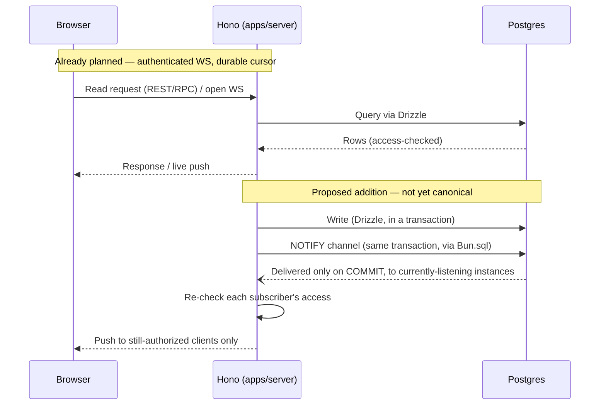

# Postgres-backed realtime: a research note for Otto

Research only — no selection made, no code changed. This evaluates whether a
third-party Postgres sync engine should replace, or sit alongside, the
authenticated WebSocket-plus-catch-up delivery already specified in
[the plan](plan.md)'s [data flow](plan.md#data-flow) (point 5) and
[Conversations and sessions](plan.md#conversations-and-sessions) sections.
Read together with [the code principles](code-principles.md) and
[the stack options](stack-options.md). The canonical plan is unchanged by
this note.

## Otto vs. Buzz

Buzz (this repository's current product) is a Nostr relay: one signed-event
log is the source of truth, and the relay's own WebSocket protocol *is* the
sync mechanism — nothing here touches it. Otto is a separate, not-yet-built
app: relational PostgreSQL records, no global event log, "a small persisted
update cursor for reconnect" (plan, [Data flow](plan.md#data-flow)). The
options below are evaluated only against that design.

## Three things these tools must not be confused with

1. **Agent activity streaming** (live tool-call/token output over the
   existing ACP/WebSocket connection) is not a Postgres-row-sync concern —
   none of the tools below touch it.
2. **Presence/typing** is already planned as ephemeral ("stays temporary,"
   plan §Data flow) — a small existing feature, not a reason to adopt a
   sync engine.
3. **Row/table sync is not collaborative document editing.** The plan
   explicitly defers CRDT-style "real-time document co-editing." Nothing
   below reopens that; syncing rows faster is unrelated to merging
   concurrent edits to one field.

Garage (file/artifact bytes) is untouched by every option below — all of
them sync Postgres rows, not blob storage.

## What never flows through any sync surface, regardless of option

- Private Session context and Connection credentials are never published,
  synced, or replicated to a client — only an explicit allowlist of
  browser-safe tables/columns is ever exposed.
- The atomic Run+pg-boss admission transaction (plan, [Automations and
  workflows](plan.md#automations-and-workflows)) is unchanged by any option
  here. Some of these tools do write their own internal state to Postgres
  when configured to use it (Zero's CVR/change schemas, PowerSync's bucket
  storage) — that is bookkeeping for the sync layer itself, not an Otto
  domain write. None of them may create or modify an Otto Run or pg-boss
  admission record outside that one existing transaction; any write-path
  integration (e.g. a Zero custom mutator) must call into the same
  authoritative domain admission function Hono already uses, not duplicate
  it.
- No agent is ever launched by an optimistic client write or a replayed
  sync/CDC event — only by the existing authoritative Run-admission path.
  Row-sync and agent-activity streaming are different problems (see above);
  conflating them would mean an unauthenticated or stale replay could
  trigger execution.

## Baseline: planned WebSocket, with native NOTIFY as a proposed addition

The authenticated WebSocket and durable persisted cursor are already in
[the plan](plan.md#data-flow). Native `LISTEN`/`NOTIFY` is **not** — it is
this note's proposed mechanism for the server to wake up and push without
polling, shown below, not yet part of the canonical design:

Reconnect (also proposed): client sends its last cursor → Hono re-derives a
commit-safe replay or gap-free snapshot of saved messages/activity (see
Native option, below) → resumes live push. Reconnect is **not** limited to
that message/activity stream: any other currently-open, access-checked view
backed by a current record — an open Task, Document, or similar — must also
be explicitly re-fetched as an authorized snapshot at reconnect, scoped to
whatever that view is currently showing. TanStack Query's own
network-reconnect refetch defaults are a browser-level heuristic (window
refocus/connectivity), not an acknowledgement of *this* WebSocket's own
catch-up contract — relying on them alone would silently skip exactly the
gap this design exists to close.

## Options compared

### Electric

Read-only sync: clients subscribe to **Shapes** (table + WHERE + columns)
over HTTP, kept live via logical replication. Writes explicitly go back
through your own API, not through Electric.

- **Deployment**: one Elixir service (Docker), PG ≥14 with logical
  replication and a `REPLICATION` role; default pool 20
  (`ELECTRIC_DB_POOL_SIZE`); most poolers don't support replication except
  pgBouncer ≥1.23. Designed to run on a private network behind your own
  authorizing proxy — not exposed directly to clients — plus an optional
  caching layer (Nginx/Caddy/CDN) in front of that proxy for performance.
  ([Deployment guide](https://electric.ax/docs/sync/guides/deployment))
- **Auth**: no built-in domain auth — "it's all just HTTP." A proxy in front
  of Electric must pin table/WHERE/columns and validate credentials.
  ([Auth guide](https://electric.ax/docs/sync/guides/auth))
- **Revocation of already-open shapes**: not automatic. Mitigations are
  `Vary: Authorization`/`Cookie` cache keys and client-side 401/403 handling
  — the application does the invalidation, same obligation as the native
  option below.
- **Query expressiveness**: WHERE-clause **subqueries are GA** as of the
  project's August 2026 release notes (e.g. membership-in-related-table
  filters), not limited to flat single-table filters. Re-verify against
  whatever release is actually pinned — this project ships fast.
  ([Releases](https://github.com/electric-sql/electric/releases))
- **Storage is persistent and must stay coherent with Postgres, by
  design, not as an open risk**: Electric's docs state that the on-disk
  shape log and the Postgres-side replication publication/slot are one
  coupled piece of state, not two independent ones.
  `ELECTRIC_STORAGE_DIR` must survive restarts; changing it, or switching
  `DATABASE_URL`, requires manually cleaning up the other side (deleting the
  on-disk shape log, or dropping the replication slot/publication) —
  otherwise the two diverge. This is a stated operational requirement to
  plan for (a persistent volume, a cleanup procedure on config change), not
  a gap in the documentation.
  ([Deployment guide](https://electric.ax/docs/sync/guides/deployment))
- **Client cache**: Electric's plain JS/React client can be used directly
  (no required second store); [TanStack DB](https://tanstack.com/db) is an
  optional, commonly-paired layer for local reactive queries over synced
  shapes. If adopted, pick one owner for that record set — don't run
  TanStack Query and TanStack DB over the same data at once.
- **License**: Apache-2.0.
- **Missing proof**: failover behavior if the service restarts with the
  storage volume lost but the Postgres slot intact (or vice versa), and
  shape-revocation latency — not exercised against Otto's schema.

### Zero (Rocicorp)

Synced Queries (reads) and Custom Mutators (writes) are both named
operations your server implements — current samples
([zslack](https://zero.rocicorp.dev/docs/samples): Expo/Hono/Drizzle/Bun;
[ztunes](https://zero.rocicorp.dev/docs/samples): TanStack/Drizzle/Better
Auth) show server-side Drizzle adapters that can **call the same internal
domain functions** Hono already calls — this does not have to be a
duplicated, parallel auth implementation, though it is a second *entry
point* into those functions that needs the same scrutiny as the Hono one.

- **Deployment**: `zero-cache` service plus your `/query` and `/mutate`
  endpoints. Its CVR ("client view record") and change-log state can live
  in your **existing Postgres instance** — this is +1 service and some
  extra Postgres state, not a mandatory second database.
- **Auth**: cookie/opaque-token based (JWT no longer required); "Zero does
  not have (or need) a first-class permission system like RLS" — your
  endpoint filters.
- **Revocation**: `ZERO_AUTH_REVALIDATE_INTERVAL_SECONDS` and
  `ZERO_AUTH_RETRANSFORM_INTERVAL_SECONDS` are **both unset by default**.
  Set, they **bound** how stale a revoked permission can get before
  `zero-cache` re-checks it — they don't make revocation instant, and
  leaving them unset means no automatic re-check at all until the client
  calls `updateAuth` or reconnects.
- **License**: Apache-2.0.
- **Missing proof**: Bun compatibility of Zero's own server-side query/
  mutator packages in Otto's exact Drizzle setup; CVR-in-shared-Postgres
  operational behavior under Otto's write volume.

### Supabase Realtime (standalone)

Elixir/Phoenix service with three features: **Postgres Changes**
(logical-replication row events), **Broadcast**, **Presence**.

- **Deployment**: one Elixir/Phoenix service; needs a replication slot per
  instance. A stalled/disconnected instance lets the slot grow unboundedly
  and can fill disk (`max_slot_wal_keep_size` is the mitigation).
- **Authorization has two different rules, not one**:
  - Postgres Changes: RLS is evaluated per event for INSERT/UPDATE, but
    **Supabase's own docs state RLS cannot apply to DELETE** — Postgres has
    no way to check access against a row that's already gone — so a DELETE
    event bypasses row-level authorization entirely (filtering one at all
    additionally requires `REPLICA IDENTITY FULL`). Do not treat Postgres
    Changes as uniformly RLS-safe across all event types.
  - Broadcast/Presence: channel access is checked once at subscribe and
    **cached for the connection's life**, re-checked only when a fresh JWT
    is sent — a mid-session revocation otherwise persists until JWT expiry.
  ([Postgres Changes](https://supabase.com/docs/guides/realtime/postgres-changes),
  [Authorization](https://supabase.com/docs/guides/realtime/authorization))
- **License**: Apache-2.0.
- **Fit**: duplicates what Otto's own WebSocket+catch-up already does, adds
  a WAL-growth operational risk, and its one genuinely distinct feature
  (Presence) is already a small planned item.

### PowerSync

Offline-first: self-hosted **PowerSync Service** partially replicates
Postgres into per-client buckets via **Sync Streams** (current name; older
docs call the equivalent "Sync Rules," now legacy terminology for the same
mechanism). Clients keep a local SQLite replica.

- **Deployment**: PowerSync Service (Docker) + bucket storage, which **can
  be Postgres** (MongoDB is not mandatory) — so, like Zero, this is +1
  service + extra Postgres state, not two mandatory separate databases.
- **Writes**: client → local SQLite → upload queue → your backend's
  `uploadData()`.
- **License**: the Service image is explicitly **FSL-1.1-ALv2**
  (source-available, free self-host, non-compete clause, converts to
  Apache-2.0 two years after each release); client SDKs are Apache-2.0.
  ([Licensing](https://powersync.com/legal/licensing-terms))
- **Fit**: built around persistent offline SQLite for mobile/desktop —
  Otto's first usable version is web-first and always-connected, so this
  solves a problem Otto doesn't have yet.

### Native LISTEN/NOTIFY + Otto's planned WebSocket

- **Hard limits**: payload <8000 bytes by default; delivery only to
  currently-connected listeners — "PostgreSQL only delivers to connected
  listeners, so notifications sent in between are lost"
  ([NOTIFY reference](https://www.postgresql.org/docs/current/sql-notify.html);
  [Bun SQL docs](https://bun.sh/docs/runtime/sql#listen--notify-postgresql)).
- **Bun's native SQL client documents direct support for this**:
  `Bun.sql`'s `listen()`/`notify()` share one dedicated connection,
  reconnect with exponential backoff (250ms→32s, jittered) and
  re-subscribe every channel, and take an **optional third callback that
  runs on initial subscribe and after every reconnect** — documented as
  "the place to catch up." `notify()` inside `sql.begin()` delivers on
  `COMMIT`, drops on `ROLLBACK`. This is a Bun runtime capability, not a
  library choice — subject to confirming it against Otto's pinned Bun
  release and whichever Drizzle driver is selected (only `Bun.sql`-backed
  Drizzle gets this API; `postgres.js`/`node-postgres` would not).
- **What this does *not* give you for free — real work either way**:
  - **Revocation is not automatically immediate just because there's no
    separate sync-engine cache.** Otto still has live WebSocket connections
    and a client-side TanStack Query cache; "stops future delivery" is only
    true if Otto's own server checks access on every outgoing delivery and
    actively drops/closes a revoked participant's subscription and the
    client clears its cached data. That's application code Otto must write
    — the same category of obligation as every option above, not a reason
    native is inherently safer.
  - **Race-free catch-up is a design responsibility, not a byproduct of the
    plan, and the obvious shortcuts are unsafe.** An identity/sequence
    column is assigned when a row is allocated, not when its transaction
    commits, so a concurrent, slower transaction can commit later with an
    earlier-looking value. An ordinary application timestamp (e.g. `now()`
    captured at transaction start) has the same problem — it reflects
    when the transaction *started*, not when it became visible to other
    readers — and a timestamp alone is not proven unique under concurrent
    writers either. A client resuming from "the last value I saw" can
    silently skip a row on either shortcut. The simplest correct approach
    is a full snapshot/refetch on reconnect with a **gap-free handoff** to
    the live stream — start listening *before* taking the snapshot, so
    nothing committed in between is missed. (A commit-ordered replay off
    Postgres's logical replication stream is possible but not required;
    snapshot-plus-live-handoff is enough and doesn't need replication set
    up at all.) The plan's "small persisted cursor" states the requirement;
    it does not hand you a race-free implementation of it.
- **No separate service, no new license, no new Postgres configuration, and
  — per the Bun finding — potentially no new client library.**

### Briefly: Instant and GraphQL

- **InstantDB**: open-source and self-hostable. Its core fit problem for
  Otto is architectural, not organizational: Instant's own
  triple-store/auth/storage model is a different foundation than Otto's
  plain Drizzle-over-Postgres relational tables, so adopting it means
  adopting its data model, not layering sync onto Otto's existing schema.
  The Instant Cloud wind-down after OpenAI's acquisition of the team is a
  secondary concern for a self-hosting user, worth tracking but not the
  main reason to set it aside. ([Self-hosting](https://www.instantdb.com/docs/self-hosting))
- **Hasura / PostGraphile**: both self-hostable with GraphQL subscriptions
  over Postgres — PostGraphile's subscriptions are user-defined fields
  delivered over WebSocket, backed by `pgSubscriber` using `LISTEN`/`NOTIFY`
  under the hood ([PostGraphile
  docs](https://postgraphile.org/postgraphile/next/subscriptions/)); Hasura
  exposes GraphQL subscriptions directly over Postgres
  ([Hasura docs](https://hasura.io/docs/2.0/subscriptions/postgres/index/)).
  Neither one on its own implies a mandatory separate authorization
  implementation — both can call into existing server-side logic. Adopting
  either would still mean running a second API style (GraphQL) alongside
  Otto's chosen Hono RPC, a consistency/maintenance cost rather than a
  technical blocker. Included for completeness, not evaluated further.

## Comparison

| | Electric | Zero | Supabase RT | PowerSync | Native (Bun.sql + WS) |
| --- | --- | --- | --- | --- | --- |
| Extra service(s) | 1 (Elixir) | 1 (+ Postgres state) | 1 (Elixir) | 1 (+ Postgres state) | 0 |
| Needs logical replication | Yes | Yes | Yes | Yes | No |
| Second write entry point | No (read-only) | Yes, can call same domain fns | No | Yes (upload queue) | No |
| Revocation: who does the work | App (cache-key + 401 handling) | App, bounded by revalidate interval (unset by default) | Mixed: DELETE bypasses RLS entirely; Broadcast/Presence cached per-connection | Not evaluated in depth | App — same obligation, no separate cache to forget about |
| Second client cache vs. TanStack Query | Optional (TanStack DB) | Yes (own client store) | No | Yes (local SQLite) | No |
| License | Apache-2.0 | Apache-2.0 | Apache-2.0 | FSL-1.1-ALv2 (service) | N/A |

## Recommendation: library vs. initial build

**For Otto's initial version: build the native path, add no library.**
"Native" here does **not** mean reimplementing Electric's shape/replication
machinery or Zero's CVR/incremental-view-maintenance engine — Otto has no
need for a general row-sync engine yet. It means the much smaller, already
plan-shaped flow: a commit fires `NOTIFY`, Hono checks each open WebSocket
connection's current access before forwarding, an authorized client
invalidates its TanStack Query cache and refetches current records, and
reconnect explicitly re-snapshots both the durable saved-message/activity
cursor the plan already requires *and* any other open, access-checked
current-record view (Task, Document, etc.) — not left to TanStack Query's
own network-reconnect defaults. The additional application code this note
calls for is
specifically the **gap-free notify/reconnect delivery logic** (commit-safe
replay, access re-check per delivery) — not a sync engine. Otto's existing
internal authorize-and-mutate domain functions stay the single owner of
authorization and writes either way; nothing here proposes a second copy of
them.

**Electric is the option worth a measured future spike** if a specific
client view genuinely needs row-level incremental sync that hand-written
query invalidation makes awkward (e.g., a complex filtered list that should
update without a full refetch, independent of any one open WebSocket). It
stays strictly read-side, needs no second write-auth surface, carries no
license non-compete clause, and its client can be adopted without
TanStack DB. This is a condition to watch for, not a default to reach for
without that measured need.

**Zero is the stronger alternative specifically if Otto later decides it
wants full app-wide, query-driven reactivity** (every view live-updating
through one sync layer, rather than per-screen WebSocket handling) — its
own sample apps individually combine Hono, Drizzle, Bun, and Better Auth,
which shows the stack combination is plausible, not that Otto's specific
combined usage has been verified compatible. That's a larger architectural
commitment than Otto's initial scope calls for, so it's a "reconsider if the
app's shape changes," not a "never." Supabase Realtime's one genuinely
distinct feature (Presence) is already a small planned item, and PowerSync
solves an offline-SQLite problem Otto doesn't have — those two are the ones
without a clear future trigger to revisit.

## Proof gates (required before any option, including "none," ships)

- [ ] Access is re-checked on every delivery path a revoked participant
      could still reach, and the client clears its own cache on removal.
- [ ] Reconnect catch-up is proven race-free against concurrent commits —
      commit-ordered replay or a gap-free snapshot-then-live handoff, not an
      identity/sequence/timestamp column read as if it were commit order.
- [ ] Chosen Postgres driver confirmed under Otto's pinned Bun release
      (for native: `Bun.sql`; for a library: its own server package).
- [ ] If a library is ever chosen: its replication-slot/connection-pool
      behavior exercised against Otto's actual schema and write volume, not
      assumed from documentation alone.
- [ ] Private Session context and Connection credentials are confirmed
      excluded from whatever is published/synced (only browser-safe
      tables/columns allowlisted); the atomic Run+pg-boss admission
      transaction is unchanged; no agent launch is ever triggered by an
      optimistic client write or a replayed sync event — only by the
      existing authoritative Run-admission path.

## Sources checked

- Electric: [sync overview](https://electric.ax/docs/sync/),
  [deployment](https://electric.ax/docs/sync/guides/deployment),
  [auth](https://electric.ax/docs/sync/guides/auth),
  [releases](https://github.com/electric-sql/electric/releases),
  [repo](https://github.com/electric-sql/electric).
- Zero: [permissions](https://zero.rocicorp.dev/docs/permissions),
  [samples](https://zero.rocicorp.dev/docs/samples),
  [zero-cache config](https://zero.rocicorp.dev/docs/zero-cache-config),
  [repo](https://github.com/rocicorp/mono).
- Supabase Realtime: [self-hosting](https://supabase.com/docs/reference/self-hosting-realtime/introduction),
  [Postgres Changes](https://supabase.com/docs/guides/realtime/postgres-changes),
  [authorization](https://supabase.com/docs/guides/realtime/authorization),
  [repo](https://github.com/supabase/realtime).
- PowerSync: [setup guide](https://docs.powersync.com/intro/setup-guide),
  [self-hosted config](https://docs.powersync.com/configuration/powersync-service/self-hosted-instances),
  [licensing](https://powersync.com/legal/licensing-terms).
- Native: [Postgres NOTIFY](https://www.postgresql.org/docs/current/sql-notify.html),
  [Bun SQL listen/notify](https://bun.sh/docs/runtime/sql#listen--notify-postgresql).
- InstantDB: [self-hosting](https://www.instantdb.com/docs/self-hosting).
- GraphQL: [PostGraphile
  subscriptions](https://postgraphile.org/postgraphile/next/subscriptions/),
  [Hasura Postgres
  subscriptions](https://hasura.io/docs/2.0/subscriptions/postgres/index/).
